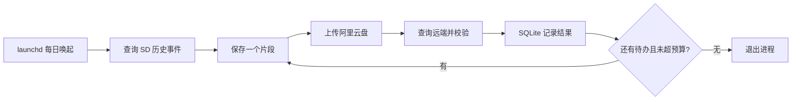

# Ezviz SD Backup

[](https://github.com/kevinalliswell/ezviz-sd-backup/actions/workflows/checks.yml)
[](LICENSE)

让全天在线的 Mac 每天自动归档萤石摄像机 SD 卡中的告警录像，并备份到阿里云盘。

A lightweight, scheduled macOS backup tool for EZVIZ SD-card event recordings and AliPan.

> **当前阶段：设计与 GitHub 基础建设。备份应用尚未实现，没有可安装的应用或可执行的备份命令。**
> 已确认官方接口提供本地录像查询与回放能力；尚未用真实 C6C 验证授权、事件索引、加密回放或视频保存。

## 目标场景

- 摄像机：萤石 C6C，录像保存在设备 SD 卡。
- 主机：24 小时在线的 Mac mini，计划支持 Apple Silicon 与 Intel；具体兼容性待测试。
- 任务：每天定时发现已有事件片段，保存 MP4，上传阿里云盘。
- 运行方式：macOS `launchd` 唤起单次任务，完成即退出；日常不保留后台进程。
- 媒体策略：优先保存原始码流，单片段、单上传串行处理，不做视频分析、转码或集锦合成。

## 设计边界

SD 卡历史回放与 RTSP 实时录像是不同能力。本项目的入口是**已有历史事件录像**，不以实时取流替代历史导出，也不要求先购买萤石云存储。

第一道门槛是：**在目标 Mac 上，用合法授权查询一个真实事件时段，并将其中 60 秒历史画面保存成可播放的视频。** 如果固件、权限、加密或协议不支持，明确报告阻塞原因，不声称已经完成备份。

开放平台使用可能另有权限、服务及流量条件；阿里云盘上传依赖第三方工具。相关能力与费用均需在实机验证时确认。



## 文档入口

| 文档 | 内容 |
| --- | --- |
| [文档导航](docs/README.md) | 阅读顺序、事实与待验证事项 |
| [需求与验收](docs/requirements.md) | 范围、资源目标、完成标准 |
| [架构设计](docs/architecture.md) | 模块、状态、故障恢复、数据流 |
| [萤石接入](docs/integrations/ezviz.md) | 官方接口、C6C 验证门槛、协议限制 |
| [阿里云盘接入](docs/integrations/alipan.md) | 上传工具、鉴权、远端校验 |
| [配置约定](docs/configuration.md) | 配置字段、目录、凭据边界 |
| [Mac 部署设计](docs/macos.md) | launchd 模板、登录与休眠行为 |
| [运维设计](docs/operations.md) | 补漏、重试、磁盘上限、清理 |
| [测试计划](docs/testing.md) | Mac 实机、故障注入、资源测量 |
| [开发路线](docs/roadmap.md) | 从能力探测到可用 MVP |
| [开发启动提示词](docs/implementation-prompt.md) | 可交给 Codex / Claude Code 的下一阶段任务 |
| [架构决策记录](docs/adr/README.md) | 技术选择及其理由 |

## 本仓库现在可以运行什么

仅可执行仓库资料检查，需要 Python 3.12+，无第三方 Python 依赖：

```sh
python3 scripts/check_repo.py
```

该检查会验证本地 Markdown 链接、示例 TOML、launchd plist 和基本仓库结构；**不会访问摄像机、登录网盘、上传视频或安装定时任务**。同一检查已配置到 GitHub Actions。

[配置示例](examples/config.example.toml)和 [launchd 模板](examples/launchd/io.github.kevinalliswell.ezviz-sd-backup.plist)是设计契约，应用实现前不能用于实际备份。

## 参与开发

请先阅读 [贡献指南](CONTRIBUTING.md)、[安全说明](SECURITY.md)及 [AGENTS.md](AGENTS.md)。提交问题时请勿上传家庭录像、设备序列号、验证码、令牌或未脱敏日志。

本项目是非官方开源项目，与萤石、海康威视及阿里云盘不存在隶属或背书关系。代码与文档以 [MIT 许可证](LICENSE)发布；第三方软件遵循各自许可证及服务条款。
