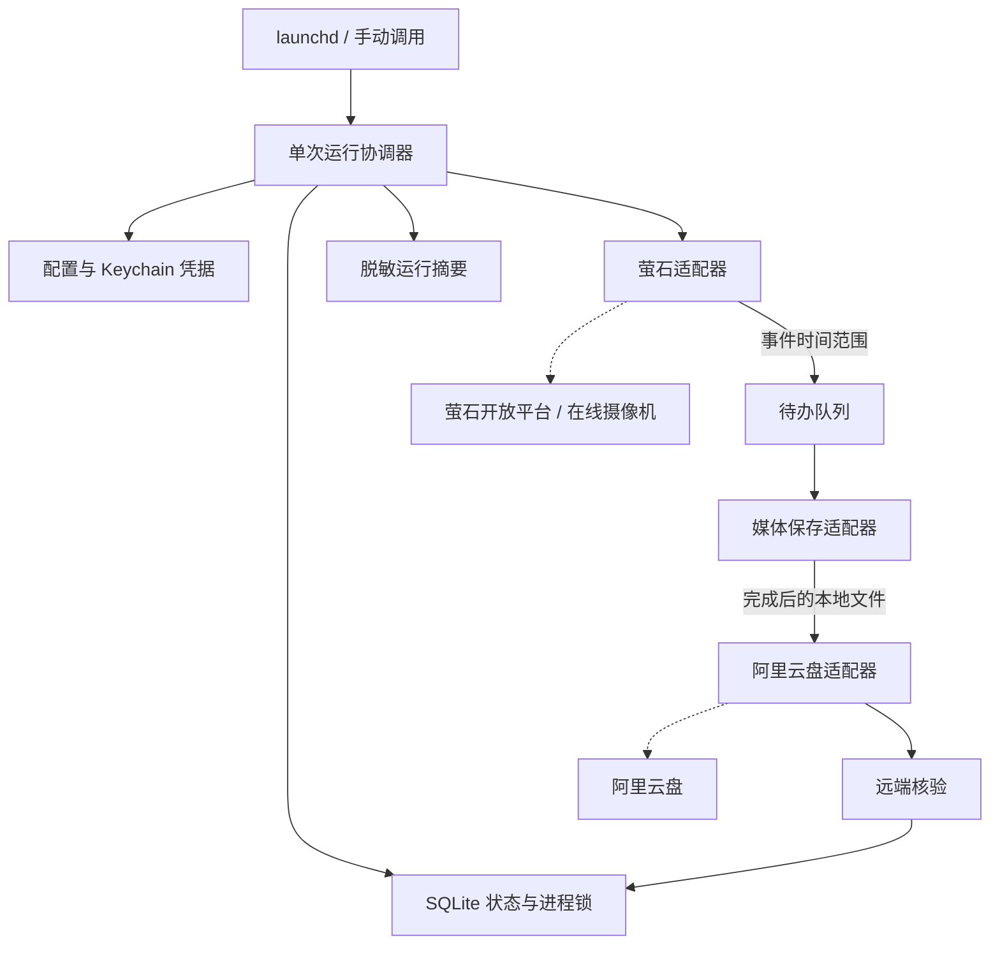
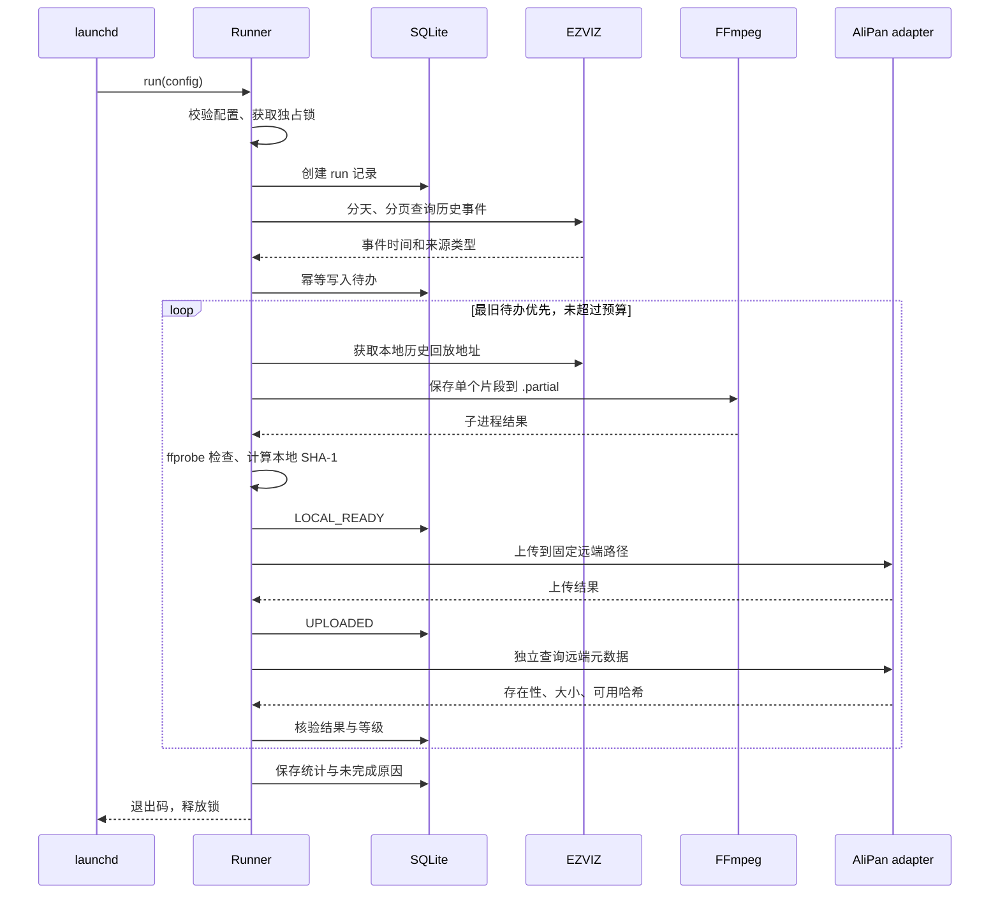
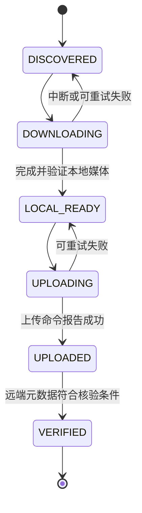

# 架构设计

## 总体选择

使用 macOS `launchd` 调度一个短生命周期的 Python CLI。任务将摄像机和网盘封装成适配器，以 SQLite 保存进度，以 FFmpeg 保存经验证可用的标准历史回放流。所有模块名称及命令均为待实现契约。

“本地录像”指 SD 卡里的来源，不代表传输必然走局域网。通过开放平台获取回放可能经过云服务；传输路径、速率和费用需要实测。

## 组件职责

| 组件 | 职责 | 资源策略 |
| --- | --- | --- |
| CLI / runner | `probe`、`run`、`status`，预算及退出码 | 无事件循环常驻；任务结束退出 |
| config / credentials | TOML 校验、路径展开、Keychain 读取 | 启动时读取；不打印值 |
| ezviz adapter | 授权、分页检索、事件归一化、回放地址 | 超时及有限重试；分页入库 |
| recorder | 启动 FFmpeg、时长及媒体检查、原子提交 | 单进程流复制；不转码 |
| alipan adapter | 上传、远端存在性/大小/哈希查询 | 单上传；封装 CLI 版本差异 |
| state | 唯一键、事务、运行结果与重试时间 | 标准库 SQLite；小事务 |
| reporting | 状态统计与可定位错误 | 有界日志；敏感信息先脱敏 |

不引入消息队列、Web 服务、容器运行时或独立调度服务。后续如需界面，在已验证的 CLI 外增加薄层。

## 一次运行的顺序

本地 SHA-1 用于与网盘提供的内容哈希比较，不用于鉴权或安全签名；哈希以有界缓冲读取。不得因为上传命令退出成功就把状态直接改为 `VERIFIED`。

## 事件与幂等

内部事件使用设备时区解释日期，保存 UTC 时间戳；所有时间区间采用 `[start, end)`。适配器负责转换为平台要求的秒、毫秒或格式化时间，并处理闭区间尾端。

稳定事件键为 `source + device_serial + channel + start_utc + end_utc + record_type` 的 SHA-256。设备序列号仅保存在本地；公开日志使用用户设定的 `camera.name`。

跨午夜或超过单片段上限的事件拆分成确定性的子片段，唯一键包含分段边界。不得截断后半段。平台相邻分页重复返回同一记录时，使用数据库唯一约束去重。若平台边界变化但覆盖已完成的同类型时段，先对照已完成区间；对异常重叠报告差异，不直接覆盖远端对象。

远端路径使用 `remote_root/camera_name/YYYY-MM-DD/HH-MM-SS_<event-key-prefix>.mp4`，日期按事件实际开始时间生成。文件名由净化后的名称及时间组成，禁止路径穿越；文件内容不同但远端同名时阻塞该对象，不覆盖已有备份。

## 状态与恢复

能力不支持、授权失效、录像已覆盖等错误存入独立的 `error_code` 和 `blocked_reason`，不把失败伪装成终态成功。每条记录同时保留 `attempts`、`retry_after` 和最近的安全错误摘要。

`VERIFIED` 还必须带 `verification_level`：`size` 或 `sha1`。只校验大小的记录不能满足默认本地清理策略；元数据缺失时仍保留 `UPLOADED`，后续运行继续核验。

崩溃恢复时：`DOWNLOADING` 对应的未完成文件重新处理；`UPLOADING` 先查询远端再决定是否重传；`LOCAL_READY` 文件保留并复用。每次恢复先检查文件存在性与哈希，不信任过期路径。

## 持久化与文件

计划建三张表：`runs` 保存执行范围和统计，`segments` 保存事件及本地/远端状态，`schema_migrations` 保存模式版本。数据库位于用户 Library 下，不入仓库；迁移前保留可恢复副本。

使用 `fcntl.flock` 获取本机独占锁，避免手动启动与定时任务同时执行。锁随进程退出释放；第二个实例记录 `skipped_locked` 并退出 0，不重复处理。

视频先写入同一文件系统的暂存文件；检查媒体流、可读性、时间和大小后用原子 rename 提交。MVP 优先验证 HTTPS HTTP-FLV：Python 用标准库以有界缓冲读取回放流，将字节传入 FFmpeg 的 stdin，后者只看见 `pipe:0`。真实签名 URL 不进入进程参数或临时清单。此路径的解码时间戳、终止行为及格式兼容性必须实测；仅有 ezopen 或无法安全处理的协议时明确阻塞，不声称已支持。

子进程统一使用参数数组、显式环境、超时及进程组终止。任务退出或收到 SIGTERM 时停止子进程并保存可恢复状态。FFmpeg stderr 必须在持久化前过滤完整 URL、查询参数、令牌和序列号。

## 退出码契约（待实现）

| 退出码 | 含义 |
| --- | --- |
| 0 | 范围处理完成、没有事件，或被已有任务安全跳过；摘要说明具体情况 |
| 2 | 配置或参数错误 |
| 3 | 授权失效，需要用户处理 |
| 4 | 当前设备、协议或事件索引能力不支持 |
| 5 | 部分任务失败或远端核验未完成 |
| 6 | 时间、空间预算耗尽，仍有待办 |

详见 [配置约定](configuration.md)、[运维设计](operations.md)和 [ADR](adr/README.md)。
